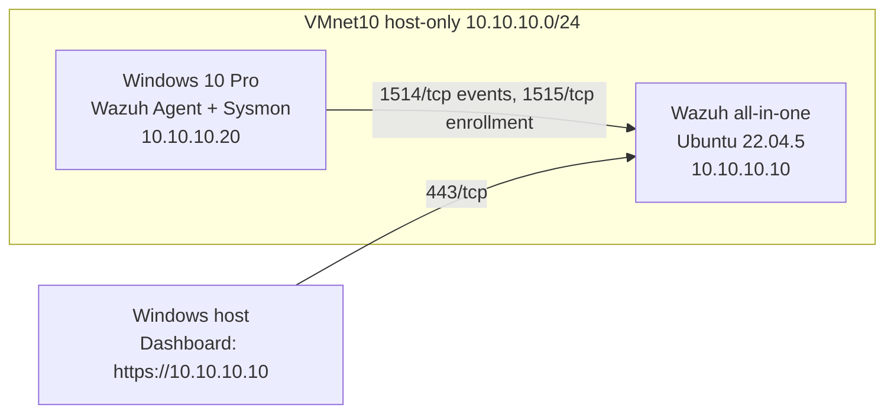

# SOC Home Lab

Dự án cá nhân: dựng SOC Home Lab bằng Wazuh trên máy 12 GB RAM để thực hành thu thập log, viết detection rule, điều tra và báo cáo sự cố. Mọi kết quả trong repo đều có bằng chứng; mục nào chưa đo được ghi rõ là chưa đo.

## Trạng thái

| Phase | Nội dung | Trạng thái |
|---|---|---|
| 1 | Preparation (VMware, VMnet10, Ubuntu) | Xong |
| 2 | Wazuh all-in-one | Xong |
| 3 | Windows endpoint (Wazuh Agent + Sysmon) | Xong |
| 4 | Detection engineering | Đang làm: S01 đã bắn rule `100100`, còn S02-S04 và tuning |
| 5 | Firewall và network monitoring (pfSense, Kali, Suricata) | Chưa bắt đầu |
| 6 | Threat hunting và incident response | Chưa bắt đầu |
| 7 | Hoàn thiện portfolio | Đang cập nhật dần |

Báo cáo đầy đủ đến hết Phase 4 (đang dở): [reports/lab-report-phase1-4.md](reports/lab-report-phase1-4.md)

## Kiến trúc hiện tại

Sơ đồ chỉnh sửa được: [diagrams/architecture.mmd](diagrams/architecture.mmd)

## Tech stack (đã triển khai)

| Thành phần | Vai trò |
|---|---|
| VMware Workstation | Ảo hóa, VMnet10 host-only |
| Wazuh 4.14 (all-in-one) | SIEM: manager, indexer, dashboard |
| Wazuh Agent | Thu log Windows |
| Sysmon (config SwiftOnSecurity) | Telemetry process, file, network |
| Windows Security log | Sự kiện đăng nhập (4624, 4625) |

Chưa triển khai: pfSense, Kali, Suricata (Phase 5), Atomic Red Team.

## Phần cứng

| Mục | Giá trị |
|---|---|
| CPU | Intel Core i5-12450HX (8 nhân, 12 luồng) |
| RAM | 11,7 GB sử dụng được |
| Ổ đĩa | SSD 512 GB; VM đặt ở ổ D (khoảng 52 GB trống lúc bắt đầu) |
| VM Wazuh | 2 vCPU, 4 GB RAM, đĩa 30 GB |
| VM Windows | 2 vCPU, 3 GB RAM, đĩa 40 GB |

## Kịch bản kiểm thử

| ID | Tên | Trạng thái |
|---|---|---|
| S01 | Đăng nhập thất bại liên tiếp | Rule bắn; còn thiếu số lần sai tại thời điểm bắn và ảnh dashboard. Xem [scenarios/failed-logons](scenarios/failed-logons/S01-failed-logons.md) |
| S02 | Process creation, parent-child | Chưa làm |
| S03 | PowerShell đáng ngờ (vô hại) | Chưa làm |
| S04 | File Integrity Monitoring | Chưa làm |
| S05 | Port scan | Phase 5 |
| S06 | Kết nối mạng đáng ngờ | Phase 5-6 |

## Cấu trúc repo

| Thư mục | Nội dung |
|---|---|
| `docs/` | Kiến trúc, mạng, hướng dẫn triển khai, detection engineering, incident response |
| `diagrams/` | Sơ đồ Mermaid |
| `configs/` | Cấu hình Sysmon và Wazuh (đã loại bí mật) |
| `detection-rules/` | Rule tùy chỉnh (`local_rules.xml`) |
| `scenarios/` | Mỗi kịch bản một thư mục, theo `_TEMPLATE.md` |
| `queries/` | Truy vấn Discover đã dùng |
| `evidence/` | Ảnh và log đã làm sạch |
| `reports/` | Báo cáo lab và incident report |

## Mở rộng repo theo mẫu

1. Mỗi phase mới: thêm mục vào `docs/deployment-guide.md` theo [docs/phase-template.md](docs/phase-template.md).
2. Mỗi kịch bản mới: sao chép `scenarios/_TEMPLATE.md` vào `scenarios/<ten-kich-ban>/`.
3. Mỗi rule mới: thêm vào `detection-rules/`, ghi giải thích vào `docs/detection-engineering.md`.
4. Mỗi sự cố điều tra: sao chép `reports/incident-reports/_TEMPLATE.md`.
5. Cập nhật bảng Trạng thái ở trên.

## An toàn

Mọi thử nghiệm chỉ chạy trong mạng lab host-only, không dùng malware thật. Không đưa mật khẩu, token, khóa hoặc file `wazuh-install-files.tar` vào repo. Che IP mạng nhà (192.168.x.x) và tên máy cá nhân trước khi đưa ảnh lên.
