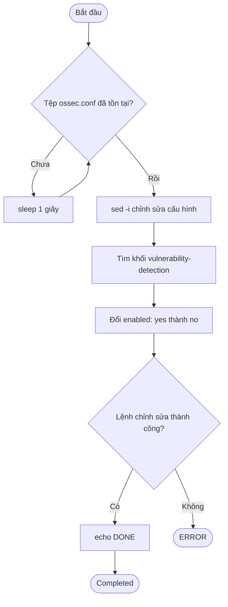

# Hướng dẫn triển khai (Phase 1-3)

Ghi chú: các lệnh dưới đây là các lệnh đã chạy trong quá trình xây lab. Phiên bản phần mềm thay đổi theo thời gian, đối chiếu với tài liệu chính thức trước khi dùng lại.

## Phase 1: Preparation

| # | Việc | Lệnh hoặc thao tác | Xác minh |
|---|---|---|---|
| 1 | Kiểm tra máy | `Get-CimInstance Win32_Processor`, `Get-PSDrive` | CPU, RAM, dung lượng trống |
| 2 | Thư mục lab | `D:\SOC-Lab\VMs`, `ISO`, `repo` | Thư mục tồn tại |
| 3 | VMnet10 | Virtual Network Editor: Add Network, Host-only, `10.10.10.0/255.255.255.0`, tắt DHCP | `ipconfig` có `10.10.10.1`; ping từ VM thành công |
| 4 | VM Wazuh | 2 vCPU, 4096 MB RAM, đĩa 30 GB (không allocate trước), NIC1 VMnet10, NIC2 NAT | Settings hiện 2 NIC |
| 5 | Ubuntu Server 22.04.5 | Bản Ubuntu Server (không minimized). `ens34` Manual `10.10.10.10/24`, không gateway. `ens33` DHCP. Cài OpenSSH | `ip -br a` |
| 6 | Mở rộng `/` | `sudo lvextend -r -l +100%FREE /dev/ubuntu-vg/ubuntu-lv`; nếu `df -h /` chưa tăng: `sudo resize2fs /dev/ubuntu-vg/ubuntu-lv` | `df -h /` hiện khoảng 28 GB |
| 7 | Cập nhật và snapshot | `sudo apt update && sudo apt -y upgrade`, shutdown, snapshot `clean-base-p1` | Snapshot có trong Snapshot Manager |


**Giải thích nhanh ý nghĩa 4 câu lệnh**:

| Command | Meaning |
|---|---|
| ```ip -br a``` | Hiển thị nhanh các card mạng, địa chỉ IP và trạng thái kết nối |
| ```df -h``` | Kiểm tra dung lượng ổ đĩa của phân vùng gốc /, gồm tổng dung lượng, đã sử dụng và còn trống |
| ```lsblk``` | Liệt kê các thiết bị lưu trữ, phân vùng và cấu trúc ổ đĩa. |
| ``` ping -c3 10.10.10.1``` | Gửi 3 gói tin ICMP đến địa chỉ 10.10.10.1 để kiểm tra khả năng kết nối mạng. |

**Giải thích 2 câu lệnh mở rộng dung lượng ổ đĩa**:

```bash
sudo resize2fs /dev/ubuntu-vg/ubuntu-lv
```
- Chức năng: Mở rộng hệ thống tệp ext2/ext3/ext4 để sử dụng dung lượng khả dụng của phân vùng Logical Volume.
- sudo: Thực thi lệnh với quyền quản trị.
- resize2fs: Công cụ thay đổi kích thước hệ thống tệp.
- /dev/ubuntu-vg/ubuntu-lv: Đường dẫn đến Logical Volume cần mở rộng.
Lưu ý: Lệnh này không tự mở rộng dung lượng Logical Volume. Nếu Logical Volume chưa được mở rộng lên 30 GB, cần tăng kích thước Logical Volume trước, sau đó mới chạy resize2fs.

```bash
sudo lvextend -r -l +100%FREE /dev/ubuntu-vg/ubuntu-lv
```
Tác dụng: Mở rộng Logical Volume (LV) bằng toàn bộ dung lượng còn trống trong Volume Group (VG), đồng thời tự mở rộng filesystem.
- sudo: Chạy lệnh với quyền quản trị.
- lvextend: Mở rộng Logical Volume.
- -r: Tự động mở rộng filesystem tương ứng sau khi tăng dung lượng LV.
- -l: Chỉ định dung lượng theo số lượng Logical Extents.
- +100%FREE: Sử dụng 100% dung lượng còn trống trong Volume Group.
- /dev/ubuntu-vg/ubuntu-lv: Đường dẫn đến Logical Volume cần mở rộng.


<p align="center">

  <br>
  <em>Hình 1: Dung lượng ổ đĩa sau khi mở rộng hệ thống tệp  </em>
</em>
</p>


## Phase 2: Wazuh all-in-one

| # | Việc | Lệnh | Xác minh |
|---|---|---|---|
| 1 | Tải script (nhánh 4.14) | `curl -sO https://packages.wazuh.com/4.14/wazuh-install.sh` | File tồn tại |
| 2 | Tắt Vulnerability Detection ngay khi `ossec.conf` xuất hiện (chạy ở phiên SSH khác, trước khi cài) | `until sudo test -f /var/ossec/etc/ossec.conf; do sleep 1; done; sudo sed -i '/<vulnerability-detection>/,/<\/vulnerability-detection>/ s#<enabled>yes</enabled>#<enabled>no</enabled>#' /var/ossec/etc/ossec.conf && echo DONE` | `grep -A3 "<vulnerability-detection>" /var/ossec/etc/ossec.conf` hiện `<enabled>no</enabled>` |
| 3 | Cài | `sudo bash ./wazuh-install.sh -a` (chạy trong `tmux`) | Cuối log in thông tin truy cập |
| 4 | Kiểm tra dịch vụ | `sudo systemctl is-active wazuh-manager wazuh-indexer wazuh-dashboard filebeat` | 4 dòng `active` |
| 5 | Theo dõi đĩa khi cài | `watch -n 10 "df -h / \| tail -1; du -sh /var/ossec"` | `/var/ossec` không vượt vài GB |
| 6 | Dashboard | `https://10.10.10.10` (chứng chỉ tự ký) | Đăng nhập được |

Mật khẩu `admin` do installer sinh ra, lưu trong trình quản lý mật khẩu, không đưa vào repo.

### **Lý do tại sao phải tắt Vulnerability Detection**:


Do trong quá trình cài đặt thì module Vulnerability Detection của Wazuh Manager tải và giải nén kho CVE (~17 GB) ngay khi manager khởi động, làm đầy ổ 28 GB. Đĩa đầy khiến indexer không phản hồi, nên securityadmin bị timeout. 


 <p align="center">

  <br>
  <em>Hình 2: Quá trình cài đặt Wazuh Dashboard bị treo do hết dung lượng  </em>
</em>
</p>

Sau đó, kiểm tra dung lượng bằng câu lệnh sau xem 15 thư mục nào chiếm nhiều dung lượng nhất trong hệ thống Linux để xác định vị trí cần giải phóng bộ nhớ lưu trữ.

```bash
sudo du -xh / --max-depth=5 2>/dev/null | sort -rh | head -15
```

+ sudo: Chạy lệnh với quyền quản trị.
+ du: Kiểm tra dung lượng sử dụng của các thư mục và tệp.
+ -x: Chỉ quét trên cùng một filesystem, không đi sang filesystem khác.
+ -h: Hiển thị dung lượng theo đơn vị dễ đọc (KB, MB, GB).
+ /: Quét từ thư mục gốc.
+ --max-depth=5: Giới hạn độ sâu quét tối đa 5 cấp thư mục.
+ 2>/dev/null: Ẩn các thông báo lỗi.
+ |: Chuyển kết quả sang lệnh tiếp theo.
+ sort -rh: Sắp xếp dung lượng theo thứ tự giảm dần.
+ head -15: Hiển thị 15 kết quả đầu tiên.


<p align="center">

  <br>
  <em>Hình 3: Kiểm tra thư mục nào chiếm nhiều nhất  </em>
</em>
</p>


 **Giải thích câu lệnh tắt Vulnerability Detection**

```
until sudo test -f /var/ossec/etc/ossec.conf; do sleep 1; done; sudo sed -i '/<vulnerability-detection>/,/<\/vulnerability-detection>/ s#<enabled>yes</enabled>#<enabled>no</enabled>#' /var/ossec/etc/ossec.conf && echo DONE
```

| Command | Meaning |
|---|---|
| ```until ...; do ...; done``` | Hiển thị nhanh các card mạng, địa chỉ IP và trạng thái kết nối |
| ```sudo test -f /var/ossec/etc/ossec.conf``` | Kiểm tra tệp cấu hình Wazuh đã tồn tại hay chưa. |
| ```sleep 1``` | Chờ 1 giây trước khi kiểm tra lại. |
| ``` sudo sed -i``` | Chỉnh sửa trực tiếp nội dung tệp. |
| ``` /<vulnerability-detection>/,/<\/vulnerability-detection>/``` | Giới hạn thao tác trong khối cấu hình vulnerability-detection. |
| ```s#<enabled>yes</enabled>#<enabled>no</enabled>#``` | Thay đổi trạng thái từ yes thành no. |
| ``` /var/ossec/etc/ossec.conf``` | Đường dẫn tệp cấu hình Wazuh. |
| ``` && echo DONE``` | In DONE nếu lệnh chỉnh sửa hoàn tất thành công.. |


**Workflow của câu lệnh**



**Giải thích câu lệnh kiểm tra sau khi đã cấu hình**

```bash
sudo systemctl is-active wazuh-manager wazuh-indexer wazuh-dashboard filebeat; df -h / | tail -1; du -sh /var/ossec; sudo grep -A3 "<vulnerability-detection>" /var/ossec/etc/ossec.conf
```


| Command | Meaning |
|---|---|
| ```systemctl is-active``` | Kiểm tra trạng thái hoạt động của các services. |
| ```wazuh-manager``` | Dịch vụ quản lý và phân tích bảo mật. |
| ```wazuh-indexer``` | Dịch vụ lưu trữ và lập chỉ mục dữ liệu. |
| ``` filebeat``` | Chuyển tiếp dữ liệu log đến Wazuh Indexer. |
| ``` df -h /``` | Kiểm tra dung lượng tổng. |
| ```tail -1``` | Chỉ hiển thị dòng cuối cùng của kết quả df. |
| ``` grep -A3 "<vulnerability-detection>``` | Tìm thẻ cấu hình vulnerability-detection và hiển thị thêm 3 dòng phía sau.|


<p align="center">

  <br>
  <em>Hình 4: Kiểm tra trạng thái dịch vụ Wazuh, dung lượng ổ đĩa và cấu hình Vulnerability Detection  </em>
</em>
</p>


## Phase 3: Windows endpoint

| # | Việc | Thao tác | Xác minh |
|---|---|---|---|
| 1 | VM Windows 10 Pro | 2 vCPU, 3 GB, 40 GB, NIC1 VMnet10, NIC2 NAT; tài khoản local | Vào được desktop |
| 2 | Đặt IP | `New-NetIPAddress -InterfaceAlias "<NIC VMnet10>" -IPAddress 10.10.10.20 -PrefixLength 24` | `ipconfig` |
| 3 | Kiểm tra mạng | `Test-NetConnection 10.10.10.10 -Port 1514` và `-Port 1515` | `TcpTestSucceeded : True` |
| 4 | Wazuh Agent | Dashboard > Agents > Deploy new agent (Windows, MSI, server `10.10.10.10`, name `win10-endpoint`); dán khối lệnh vào PowerShell Admin; `NET START WazuhSvc` | Agent trạng thái Active |
| 5 | Sysmon | `Invoke-WebRequest -Uri "https://download.sysinternals.com/files/Sysmon.zip" -OutFile "C:\Lab\Sysmon.zip"`; giải nén; tải `sysmonconfig-export.xml` của SwiftOnSecurity; `Sysmon64.exe -accepteula -i sysmonconfig.xml` | `Get-Service Sysmon64` Running |
| 6 | Cho Wazuh đọc Sysmon | Thêm khối `<localfile>` (xem tại https://github.com/justarandomguy2712/SOC_HOME_LAB/blob/8605b3afd5b22d07e5027bea0820ba72eff53611/soc-home-lab/LIST/configs/wazuh/ossec-agent-localfile-sysmon.xml.example), `Restart-Service WazuhSvc` | Sự kiện Sysmon xuất hiện trong Discover |
| 7 | Sự kiện thử | `whoami`, `hostname`, đăng nhập sai | Có ID 1, 11 và 4625 trong Discover |


<p align="center">

  <br>
  <em>Hình 5: Tải và giải nén các services Sysmon  </em>
</em>
</p>

### Mở tệp cấu hình Wazuh Agent với quyền Administrator trên Windows


```bash
Start-Process notepad.exe -Verb RunAs -ArgumentList '"C:\Program Files (x86)\ossec-agent\ossec.conf"'
```

 + Start-Process: Khởi chạy một tiến trình mới trong PowerShell.
 + notepad.exe: Mở trình soạn thảo Notepad.
 + -Verb RunAs: Chạy chương trình với quyền quản trị viên (Administrator), hiển thị yêu cầu UAC nếu cần.
+ -ArgumentList: Truyền đường dẫn tệp cần mở cho Notepad
+ "C:\Program Files (x86)\ossec-agent\ossec.conf": Đường dẫn đến tệp cấu hình Wazuh Agent trên Windows.
+ Dấu nháy đơn và dấu nháy kép lồng nhau: Giúp truyền toàn bộ đường dẫn có chứa khoảng trắng thành một đối số duy nhất.


#### 1. Sau khi vào file thì ta mở notepad -> nhấn Ctrl+End, tìm thẻ </ossec_config> cuối cùng 

#### 2. Dán ngay trước </ossec_config> với dòng lệnh sau:
``` 
<localfile>
<location>Microsoft-Windows-Sysmon/Operational</location>
<log_format>eventchannel</log_format>
</localfile>
```
Khối lệnh phải nằm trong trong cặp <ossec_config>...</ossec_config>

#### 3. PowerShell (Admin) -> Restart-Service WazuhSvc -> NO ERROR


### Kiểm thử khả năng phát hiện và ghi nhận sự kiện đăng nhập thất bại (Windows Event ID 4625) sau khi đã cấu hình trên hệ thống Wazuh SIEM :


#### 1. 

Trên VM Windows, tạo hai lần đăng nhập sai, ```Win + L``` để khóa màn hình, nhập sai mật khẩu tài khoản labuser 2 lần

+ Giải thích event ID 4625:
 
| Mục | Giải Thích |
|---|---|
| Nguồn | Windows Security log. |
| Ý nghĩa | An account failed to log on. |
| Cặp đối chiếu | 4624 = đăng nhập thành công, 4625 = thất bại |
| Dùng cho | 	Kịch bản test brute-force, MITRE T1110) |

#### 2.

Sau khi tạo các sự kiện đăng nhập thất bại tương ứng với Windows Event ID 4625, thực hiện lệnh sau trên máy ảo Windows bằng PowerShell với quyền Administrator để kiểm tra xem các sự kiện đã được ghi nhận chưa:

```Get-WinEvent -FilterHashtable @{LogName='Security';Id=4625} -MaxEvents 3 | Select TimeCreated,Id```


<p align="center">

  <br>
  <em>Hình 6: Kiểm tra sự kiện đăng nhập thất bại Windows Event ID 4625 trên máy ảo Windows bằng PowerShell  </em>
</em>
</p>


| Thành phần | Ý nghĩa |
|---|---|
| Get-WinEvent | Truy vấn các sự kiện được lưu trong Windows Event Log. |
| -FilterHashtable | Lọc sự kiện theo các điều kiện được khai báo trong Hashtable. |
| @{LogName='Security';Id=4625} | Chỉ lấy sự kiện thuộc nhật ký Security có mã sự kiện 4625. |
| -MaxEvents 3 | Giới hạn kết quả trả về tối đa 3 sự kiện. |
| ```pipeline ``` | Chuyển kết quả từ lệnh bên trái sang lệnh bên phải để xử lý tiếp. |
| Select TimeCreated,Id | Chỉ hiển thị thời điểm xảy ra sự kiện (TimeCreated) và mã sự kiện (Id). |


#### 3. 

Kiểm tra trên Wazuh Dashboard để xác nhận sự kiện đã được agent thu thập

Lọc truy vấn này trong Discover, chọn last 1 hour

```data.win.system.eventID: 4625```

<p align="center">

  <br>
  <em>Hình 7: Kiểm tra sự kiện đăng nhập thất bại trên Wazuh Dashboard  </em>
</em>
</p>

**Giải thích các mục mà Agent thu thập được**: 

| Thành phần | Giá trị | Ý nghĩa | 
|---|---|---|
| agent.name, agent.ip | win10-endpoint, 10.10.10.20 | Tên định danh và địa chỉ IP của máy Windows được cài đặt Wazuh Agent, nơi phát sinh sự kiện bảo mật. |
| eventID | 4625 | Mã sự kiện Windows Security Event ID 4625, ghi nhận đăng nhập thất bại |
| targetUserName | labuser | Tên đăng nhập của máy kiểm thử |
| subStatus | 0xc000006a | Đúng tên, sai mật khẩu |
| logonType | 2 | Đăng nhập tại máy |
| ipAddress | 127.0.0.1 | Đăng nhập sai tại chính máy localhost |


**Bảng bổ sung thêm các mã subStatus và logonType để phục vụ các bài lab sau này:**


| Mã SubStatus | Ý nghĩa |
|---|---|
| `0x0` | Không có thông tin lỗi chi tiết bổ sung trong trường này. |
| `0xC0000064` | Tên tài khoản không tồn tại hoặc bị nhập sai. |
| `0xC000006A` | Mật khẩu không chính xác. |
| `0xC000006D` | Thông tin xác thực không hợp lệ; cần kiểm tra thêm để xác định nguyên nhân cụ thể. |
| `0xC000006E` | Tên tài khoản hoặc thông tin xác thực không hợp lệ theo trạng thái được báo cáo. |
| `0xC000006F` | Đăng nhập ngoài khung giờ được phép. |
| `0xC0000070` | Đăng nhập từ máy trạm không được phép. |
| `0xC0000071` | Mật khẩu đã hết hạn. |
| `0xC0000072` | Tài khoản đã bị vô hiệu hóa. |
| `0xC000015B` | Tài khoản không được cấp quyền thực hiện kiểu đăng nhập yêu cầu. |
| `0xC0000193` | Tài khoản đã hết hạn. |
| `0xC0000224` | Tài khoản cần đổi mật khẩu khi đăng nhập. |
| `0xC0000234` | Tài khoản đã bị khóa. |
| `0xC000005E` | Không có máy chủ đăng nhập khả dụng để xử lý yêu cầu. |


-------


| Giá trị LogonType | Tên kiểu đăng nhập | Ý nghĩa |
|---|---|---|
| `2` | `Interactive` | Đăng nhập trực tiếp tại máy tính, ví dụ tại màn hình Windows. |
| `3` | `Network` | Đăng nhập thông qua mạng, ví dụ truy cập SMB hoặc tài nguyên chia sẻ. |
| `4` | `Batch` | Đăng nhập phục vụ tác vụ chạy theo lịch hoặc xử lý hàng loạt. |
| `5` | `Service` | Đăng nhập phục vụ việc khởi chạy dịch vụ Windows. |
| `7` | `Unlock` | Mở khóa phiên làm việc trên máy tính. |
| `8` | `NetworkCleartext` | Đăng nhập qua mạng với thông tin xác thực được cung cấp cho gói xác thực ở dạng chưa băm. |
| `9` | `NewCredentials` | Tạo phiên đăng nhập sử dụng thông tin xác thực khác cho các kết nối đi ra. |
| `10` | `RemoteInteractive` | Đăng nhập từ xa thông qua Remote Desktop Services (RDP). |
| `11` | `CachedInteractive` | Đăng nhập tương tác bằng thông tin xác thực miền được lưu đệm cục bộ. |


