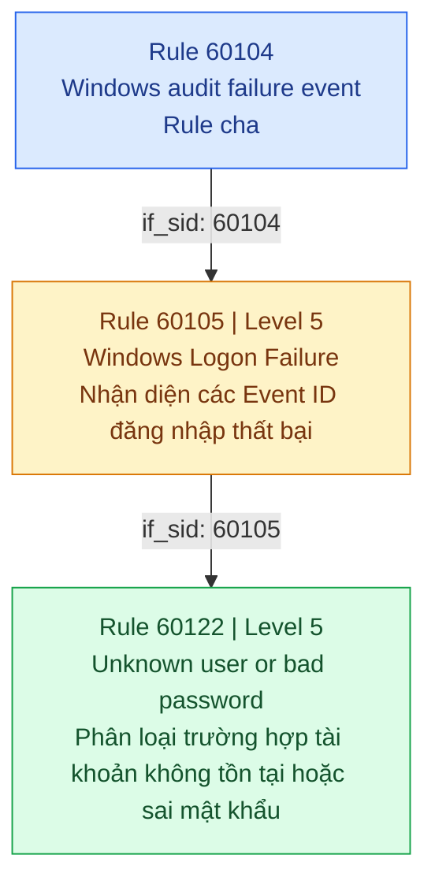

# Detection engineering (Phase 4)

## S01: Đăng nhập thất bại liên tiếp

| Mục | Nội dung |
|---|---|
| Mục tiêu | Phát hiện nhiều lần đăng nhập Windows thất bại vào cùng một tài khoản trong thời gian ngắn |
| Kịch bản | Brute-force vào một tài khoản cụ thể |
| Điều kiện | Agent `win10-endpoint` Active; kênh Security gửi được 4625; rule `60122` bắn cho sự kiện 4625 |
| Nguồn log | `win10-endpoint` (10.10.10.20); Windows Security log, event 4625 |
| MITRE ATT&CK | T1110 (Brute Force) |

### Hành vi kiểm thử

1.1. Khảo sát và đánh giá các Rule mặc định đối với hành vi đăng nhập thất bại


Đầu tiên, tiến hành truy xuất các cảnh báo được ghi nhận trong file ```alerts.json``` nhằm xác định Rule ID, mức độ cảnh báo (Level) và mô tả tương ứng với sự kiện Event ID 4625. Sau đó, thực hiện tìm kiếm trong thư mục Ruleset mặc định của Wazuh để xác định file cấu hình và nội dung Rule liên quan.

Quá trình này giúp làm rõ cơ chế phát hiện đăng nhập thất bại hiện có của Wazuh, đồng thời cung cấp cơ sở để phân tích, điều chỉnh và xây dựng các Custom Rule nhằm nâng cao khả năng giám sát và phát hiện các hành vi đăng nhập bất thường trong hệ thống.

*Ta dùng hai câu lệnh như sau:*

**Câu lệnh thứ nhất**:


```sudo grep '"eventID":"4625"' /var/ossec/logs/alerts/alerts.json | tail -3 | grep -o '"rule":{"level":[0-9]*,"description":"[^"]*","id":"[0-9]*"'```


 **Mục đích: Truy xuất 3 cảnh báo gần nhất liên quan đến Event ID 4625 trong Wazuh, sau đó trích xuất thông tin Rule ID, Level và Description tương ứng.**


| Command | Meaning |
|---|---|
| ```sudo grep '"eventID":"4625"'``` | Thực thi với quyền root để lọc ra EventID 4625. |
| ```/var/ossec/logs/alerts/alerts.json``` | File JSON lưu trữ các cảnh báo do Wazuh tạo ra. |
| ```tail -3``` | Lấy 3 dòng cuối cùng trong kết quả lọc. |
| ``` grep -o``` | 	Chỉ hiển thị phần nội dung khớp với biểu thức tìm kiếm. |
| ``` rule":{"level":[0-9]*,"description":"[^"]*","id":"[0-9]*``` | Lấy thông tin Rule bao gồm Level, Description và ID.|


**Câu lệnh thứ hai**:

```sudo grep -rn -i "logon failure" /var/ossec/ruleset/rules/ | head -5```

**Mục đích: Lấy 5 kết quả đầu tiên liên quan đến cụm từ "Logon Failure" trong toàn bộ thư mục Ruleset mặc định của Wazuh, nhằm xác định file cấu hình và vị trí khai báo các Rule phục vụ phát hiện hành vi đăng nhập thất bại.**


| Command | Meaning |
|---|---|
| ```-r``` | Tìm kiếm đệ quy trong toàn bộ thư mục và thư mục con.. |
| ```-i``` | Không phân biệt chữ hoa và chữ thường. |
| ``` logon failure``` | 	Chuỗi từ khóa cần tìm kiếm. |
| ```  head -5 ``` | Chỉ hiển thị 5 kết quả đầu tiên.|
| ```  -n ``` | Hiển thị số dòng.|

Và **Output** của 2 câu lệnh này cho ta kết quả như sau:

```bash
/var/ossec/ruleset/rules/0580-win-security_rules.xml:66:    <description>Windows Logon Failure</description>
/var/ossec/ruleset/rules/0580-win-security_rules.xml:270:    <description>Logon Failure - Unknown user or bad password</description>
/var/ossec/ruleset/rules/0580-win-security_rules.xml:281:    <description>Logon Failure - Account logon time restriction violation</description>
/var/ossec/ruleset/rules/0580-win-security_rules.xml:292:    <description>Logon Failure - Account currently disabled</description>
/var/ossec/ruleset/rules/0580-win-security_rules.xml:303:    <description>Logon Failure - Specified account expired</description>
```

|Dòng |	Description | Ý nghĩa |
|---|---|---|
|66|Windows Logon Failure	|Mô tả chung cho hành vi đăng nhập Windows thất bại.|
|270|	Unknown user or bad password|	Tài khoản không tồn tại hoặc mật khẩu không chính xác.|
|281|	Account logon time restriction violation|	Vi phạm giới hạn thời gian đăng nhập của tài khoản.|
|292|	Account currently disabled|	Tài khoản hiện đang bị vô hiệu hóa|
|303|	Specified account expired	|Tài khoản đã hết hạn sử dụng.|

Thông qua 2 câu lệnh này ta đã xác định được file chứa ruleset mặc định (0580-win-security_rules.xml), từ đó có thêm dữ liệu để viết custom rule cho chính xác hơn

---


Sau khi xác định được file chứa Ruleset mặc định, bước tiếp theo là phân tích các điều kiện và trường dữ liệu mà Rule sử dụng để kích hoạt cảnh báo.


*Ta dùng 2 câu lệnh như sau:*


**Câu lệnh thứ nhất**:

```sudo sed -n '58,75p;262,278p' /var/ossec/ruleset/rules/0580-win-security_rules.xml``` 

**Mục đích: Trích xuất nội dung tại hai khoảng dòng cụ thể trong file Ruleset để khảo sát cấu trúc các Rule mặc định.**


| Command | Meaning |
|---|---|
| ```sed``` | Tìm kiếm đệ quy trong toàn bộ thư mục và thư mục con. |
| ```-n``` | Không tự động in toàn bộ nội dung file. |
| ```58,75p``` | 	In các dòng từ 58 đến 75. |
| ``` 262,278p``` | 	In các dòng từ 262 đến 278. |
| ```  0580-win-security_rules.xml ``` | File chứa các Rule mặc định liên quan đến Windows Security.|


**Câu lệnh thứ hai**: 

```sudo grep -n "frequency\|if_matched_sid" /var/ossec/ruleset/rules/0580-win-security_rules.xml | head```

**Mục đích: Tìm kiếm các thành phần frequency và if_matched_sid trong file Ruleset nhằm kiểm tra sự tồn tại của các cơ chế phát hiện dựa trên events.**


| Command | Meaning |
|---|---|
| ```grep``` | Tìm kiếm chuỗi ký tự trong file. |
| ```-n``` | Hiển thị số dòng trong file. |
| ```frequency``` | 	Tần suất cần đạt ngưỡng đã cấu hình để kích hoạt các event alert. |
| ``` \|``` | 	Toán tử OR trong biểu thức tìm kiếm của grep. |
| ```  if_matched_sid ``` |Tham chiếu đến SID của một Rule đã được kích hoạt trước đó.|
| ```  head ``` |Hiển thị 10 dòng đầu tiên (Mặc định)|


Và **Output** của câu lệnh đầu tiên cho ta kết quả như sau:

*Rule ID cha 60105 – Windows Logon Failure*


```bash
<rule id="60105" level="5">
    <if_sid>60104</if_sid>
    <field name="win.system.eventID">^529$|^530$|^531$|^532$|^533$|^534$|^535$|^536$|^537$|^539$|^4625$</field>
    <description>Windows Logon Failure</description>
    <options>no_full_log</options>
    <group>authentication_failed,...</group>
    <mitre>
      <id>T1078</id>
    </mitre>
</rule>
```

|Thành phần |	Giá trị | Ý nghĩa |
|---|---|---|
|ID| 60105	|Rule phát hiện đăng nhập thất bại.|
|if_sid|	60104|	Chỉ xét sự kiện đã thỏa mãn Rule cha 60104.|
|field|	win.system.eventID|		Trường dữ liệu chứa mã sự kiện Windows.|
|Regex|	^529$...^4625$|	Đối chiếu Event ID với danh sách các mã đăng nhập thất bại.|
|mitre|	T1078	|Liên kết với kỹ thuật Valid Accounts trong MITRE ATT&CK.|


*Rule ID 60122 – Phân loại nguyên nhân đăng nhập thất bại*

```bash
<rule id="60122" level="5">
    <if_sid>60105</if_sid>
    <field name="win.system.eventID">^529$|^4625$</field>
    <description>Logon Failure - Unknown user or bad password</description>
</rule>
```


|Thành phần |	Giá trị | Ý nghĩa |
|---|---|---|
|ID| 60122	|Rule phát hiện đăng nhập thất bại.|
|if_sid|	60105|	Rule này phụ thuộc vào Rule 60105.|
| description | Unknown user or bad password | Tài khoản không tồn tại hoặc mật khẩu không chính xác. |


**Sơ đồ mối quan hệ giữa các Rule:**



---

Tiếp đến phân tích **Output** của câu lệnh thứ hai cho kết quả như sau:

```bash
1126: <rule id="60203" level="10" frequency="$MS_FREQ" timeframe="240">
1127:   <if_matched_sid>60107</if_matched_sid>

1137: <rule id="60204" level="10" frequency="$MS_FREQ" timeframe="240">

1148: <rule id="60205" level="10" frequency="$MS_FREQ" timeframe="240">
1149:   <if_matched_sid>60104</if_matched_sid>

1156: <rule id="60206" level="10" frequency="$MS_FREQ" timeframe="240">
1157:   <if_matched_sid>60102</if_matched_sid>

1162: <rule id="60207" level="10" frequency="$MS_FREQ" timeframe="120">
1163:   <if_matched_sid>60101</if_matched_sid>
```


|Thành phần |	Giá trị | Ý nghĩa |
|---|---|---|
|ID| 60203 – 60207	|ID của các Rule tương quan.|
|frequency|	$MS_FREQ|	Tần suất xuất hiện để dạt ngưỡng kích hoạt sự kiện theo cấu hình của Rule. |
| timeframe | 240 hoặc 120 | Khoảng thời gian tính bằng giây để kiểm tra tần suất sự kiện. |
| if_matched_sid | 60107, 60104... | Tham chiếu Rule ID trước đó. |

--- 

Khảo sát các thành phần cần thiết trước khi xây dựng Custom Rule


| Thành phần cần khảo sát | Kết quả |  Ghi chú |
|---|---|---|
| Rule nhận diện đăng nhập thất bại | **Đã xác định:** `60122` | Rule mặc định, phân loại trường hợp tài khoản không tồn tại hoặc sai mật khẩu (Event ID `4625`). |
| Trường dữ liệu tài khoản | **Đã xác định:** `win.eventdata.targetUserName` | Wazuh Discover hiển thị `data.win.eventdata.targetUserName`; khi khai báo trong Rule sử dụng tên trường tương ứng theo cấu trúc dữ liệu của Wazuh. |
| ID Custom Rule | **Đã lựa chọn:** `100100` | Custom Rule được Wazuh cung cấp các ID `100000` trở lên. |
| Cú pháp phát hiện theo tần suất | **Đã xác định** | Tham khảo các thuộc tính `frequency`, `timeframe`, `if_matched_sid` và `same_field` trong Ruleset mặc định. |
| Giá trị biến `$MS_FREQ` | **Chưa xác định** | Cần tìm nơi khai báo biến để xác định ngưỡng số lần xuất hiện sự kiện. |
| Điều kiện của Rule `60204` | **Chưa xác định được** | Cần kiểm tra nội dung Rule để xác định loại sự kiện và chức năng phát hiện, tránh trùng lặp với Custom Rule `100100`. |


Từ những thông tin còn thiếu, quá trình khảo sát sẽ tập trung vào hai nội dung chính:

1. Xác định giá trị $MS_FREQ

Trong các Rule 60203–60207, Wazuh sử dụng biến $MS_FREQ làm giá trị cho thuộc tính frequency. Do đó, cần truy tìm nơi khai báo biến này để xác định chính xác ngưỡng số lần xuất hiện sự kiện và khoảng thời gian tương ứng.

2. Phân tích Rule 60204

Cần kiểm tra toàn bộ nội dung Rule 60204, đặc biệt là các điều kiện <if_matched_sid>, <field>, <same_field> và phần <description>. Việc này giúp xác định Rule đang theo dõi loại sự kiện nào, có liên quan đến đăng nhập thất bại hay không và liệu Custom Rule 100100 có nguy cơ trùng lặp chức năng.


---


Để phân tích và tìm giá trị của $MS_FREQ và Rule 60204 thì ta dùng 3 câu lệnh sau:

| STT | Lệnh thực hiện | Ý nghĩa |
|---|---|---|
| 1 | `sudo grep -rn "MS_FREQ" /var/ossec/ruleset/rules/ \| head -3` | Tìm kiếm các vị trí sử dụng hoặc khai báo biến `MS_FREQ` trong Ruleset mặc định, qua đó xác định ngưỡng tần suất được áp dụng. |
| 2 | `sudo sed -n '1126,1160p' /var/ossec/ruleset/rules/0580-win-security_rules.xml` | Trích xuất nội dung các Rule từ dòng 1126 đến 1160 để khảo sát điều kiện và cơ chế phát hiện của các Rule `60203`–`60205`. |


 Phân tích **Output** của 2 câu lệnh trên cho kết quả như sau:

1. Giá trị biến $MS_FREQ
Kết quả tìm kiếm:

```bash
<var name="MS_FREQ">8</var>
```
Như vậy, biến $MS_FREQ có giá trị là 8. Các Rule sử dụng biến này sẽ áp dụng ngưỡng tần suất tương ứng là 8 lần.


2. Phân tích Rule 60204


```bash
<rule id="60204" level="10" frequency="$MS_FREQ" timeframe="240">
    <if_matched_group>authentication_failed</if_matched_group>
    <same_field>win.eventdata.ipAddress</same_field>
    <description>Multiple Windows Logon Failures</description>
</rule>
...
 <mitre>
      <id>T1110</id>
    </mitre>
  </rule>
```

Rule 60204 – Multiple Windows Logon Failures
- Level: 10.
- Frequency: 8 lần.
- Timeframe: 240 giây.
- Điều kiện: if_matched_group = authentication_failed.
- Trường nhóm sự kiện: win.eventdata.ipAddress.
- MITRE ATT&CK: T1110 – Brute Force.


**Nhận xét:** Ruleset mặc định của Wazuh đã hỗ trợ phát hiện nhiều lần đăng nhập thất bại theo địa chỉ Source IP thông qua Rule `60204`. Vì vậy, Custom Rule mới cần có tiêu chí phát hiện khác biệt để tránh trùng lặp chức năng.

---

Qua quá trình khảo sát, nhận thấy Rule `60204` đã hỗ trợ phát hiện nhiều lần đăng nhập Windows thất bại dựa trên địa chỉ IP nguồn (ở đấy có máy localhost 127.0.0.1). Vì vậy, Custom Rule S01 được định hướng theo một phương thức khác: **theo dõi số lần đăng nhập thất bại dựa trên tài khoản đích (`targetUserName`)**.

Sự khác biệt giữa hai cơ chế phát hiện được thể hiện như sau:

- **Rule mặc định `60204`:** Nhóm các sự kiện đăng nhập thất bại theo cùng địa chỉ IP nguồn (`win.eventdata.ipAddress`).
- **Custom Rule S01 (`100100`):** Hướng đến nhóm các sự kiện đăng nhập thất bại theo cùng tài khoản đích (`win.eventdata.targetUserName`).
- **Ngưỡng S01**: Cấu hình 5 lần / 60s so với 8 lần / 240s của Rule mặc định


---


Và để viết Rule Custom cho S01 thì tham khảo tại repo sau:
https://github.com/justarandomguy2712/SOC_HOME_LAB/blob/e859daf578dcb80b99d25736597aab715c839728/soc-home-lab/LIST/detection-rules/local_rules.xml


Trên Windows (cmd), tạo đăng nhập sai bằng tài khoản không tồn tại, cùng một tên cho mọi lần:


```
net use \\127.0.0.1\IPC$ /user:fakeuser SaiMatKhau1
```

Dùng `fakeuser` để tránh khóa tài khoản thật. Mỗi lần trả `System error 1326`.

### Rule

`100100` trong [../../detection-rules/local_rules.xml](../../detection-rules/local_rules.xml): đếm `60122`, `frequency="5"`, `timeframe="60"`, `same_field` theo `win.eventdata.targetUserName`, level 10.

### Truy vấn Discover

```
rule.id: 60122
rule.id: 100100
data.win.system.eventID: 4625
```

### Kết quả

| Phép đo | Giá trị |
|---|---|
| Test A: 4 lần sai | `60122` bắn 4 lần, `100100` không bắn (ảnh console) |
| Test B: sai liên tiếp | `100100` (level 10) xuất hiện trên console sau các dòng `60122` (ảnh console) |
| Bắn ở lần sai thứ mấy | **Chưa ghi nhận.** Cần đếm lại hoặc đếm từ Discover (`rule.id: 60122`) |
| Thời gian từ lần sai cuối đến alert | **Chưa đo** |
| Alert trên dashboard (Discover) | **Chưa xác nhận trong báo cáo này** |
| Pass hoặc Fail | **Chưa kết luận.** Điều kiện Pass: 4 lần không bắn (đạt), bắn ở lần 5 hoặc 6 (chưa biết lần nào) |

### Bằng chứng cần bổ sung

- Ảnh Discover `rule.id: 100100`, hiện `rule.level`, `rule.mitre.id`, `targetUserName`
- Ảnh Discover `rule.id: 60122` với giờ của từng lần sai trong Test B
- Ảnh console Test A và Test B (đã có)

## False positive có thể gặp

Người dùng thật quên mật khẩu và gõ sai nhiều lần liên tiếp. Tác vụ tự động dùng mật khẩu cũ (dịch vụ, ổ mạng ánh xạ).

## Phân tích và khuyến nghị
